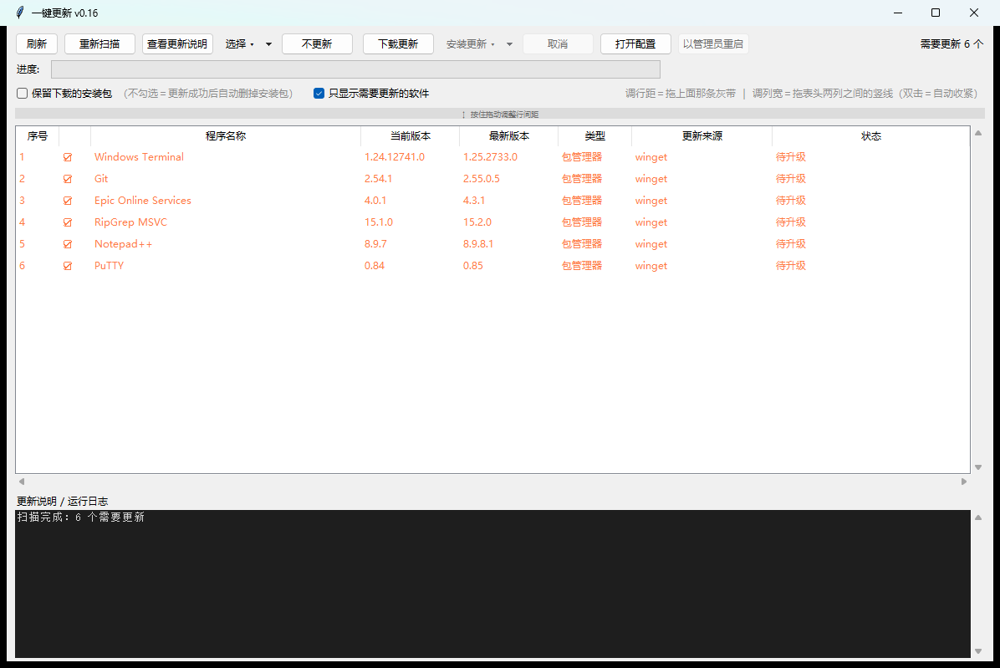

# 一键更新 · One-Click Updater

> 把电脑上所有软件一次性检查、下载、装完的 Windows 图形化更新器。
> A GUI updater that checks, downloads and installs every update for your Windows apps in one go.

[English](README.en.md) · [中文](README.md)




---

## 为什么要做这个

`winget upgrade --all` 很好用，但它有三个绕不过去的毛病：

1. **看不到在装什么** —— 一屏滚动的命令行，装完还不知道哪个失败了、为什么失败。
2. **绿色版软件它不管** —— 解压即用的工具（ripgrep、各种 portable 小工具）根本不在 winget 视野里。
3. **安装包千奇百怪** —— MSIX 报 `0x80073D02`、ZIP 被当 exe 执行报 `WinError 193`、厂商自研封装塞 `/S` 毫无反应……这些错误码喂给普通用户等于没说。

所以这个工具把整条链路做成看得见的三步：**扫描 → 下载 → 安装**，每一步都有进度、有日志、失败有人话解释。

## 功能

| 能力 | 说明 |
|---|---|
| **全盘扫描** | 注册表卸载项 + `winget list` + 指定目录的绿色版，去重合并成一张表 |
| **只显示需要更新的** | 已是最新的自动隐去；装完一个，那一行立刻消失、序号重排 |
| **版本三路核对** | winget 清单版本 / GitHub Release / 可执行文件 `ProductVersion`，读不到就标「未获取」而不是瞎猜 |
| **多连接下载** | 分段 Range 并发 + 进度 / 速度显示 + 随时取消 |
| **完整性校验** | 下载完核对文件长度与清单 SHA256，断流（声明 1000 字节只给 400）会被识别并删掉残包 |
| **网络自适应** | 代理 / 直连双通道自动切换；GitHub 直连失败自动回退镜像 |
| **两类安装** | 「依次打开安装包」（稳） / 「尝试静默安装」（快），按安装包框架自动选参数 |
| **MSIX 自动处理** | 安装前精确关闭旧版进程，避开 `0x80073D02` |
| **ZIP 两种走法** | 纯绿色版→解压覆盖（自动备份）；内含安装程序的→提取内层再运行 |
| **结果可信** | 不只看退出码，装完回读注册表版本号核对，避免「提示失败但其实装上了」 |
| **不更新名单** | 不想再看到的软件一键忽略，可随时恢复 |
| **界面可调** | 行距、列宽都能鼠标拖，配置自动记住 |

## 安装

**需要**：Windows 10 1809+ / Windows 11，Python 3.9+（安装时勾选 `tcl/tk and IDLE`）。

本项目**没有任何第三方依赖**，不需要 `pip install`。

```bat
git clone https://github.com/<your-name>/oneclick-updater.git
cd oneclick-updater
:: 双击，或：
一键更新.bat
```

首次运行会自动生成 `config.json`（可从 `config.sample.json` 复制一份改）。

## 使用

1. 启动后自动扫描，列表里是**所有需要更新的软件**（当前版本 → 最新版本）。
2. 默认全选；不想要的可以取消勾选，或点「不更新」永久忽略。
3. 点 **下载更新** → 等待进度条走完。
4. 点 **安装更新 ▾**
   - **依次打开安装包安装（推荐）**：弹出一个装一个，你点完之后自动弹下一个，装完用版本号核实。
   - **尝试静默安装（实验）**：Inno / NSIS / MSI / MSIX 这类有公开静默参数的，全程无界面。
5. 权限不够时会提示「以管理员重启」，管理员模式下走批量静默安装。

> 界面小技巧：拖动列表上方的灰带 = 调行距；鼠标移到表头两列之间的竖线（指针变 ↔）= 拖列宽，双击 = 该列自动收窄到刚好。

## 它怎么处理各种安装包

| 安装包类型 | 识别方式 | 处理方式 |
|---|---|---|
| Inno Setup | 文件内特征串 `Inno Setup Setup Data` | `/VERYSILENT /SUPPRESSMSGBOXES /NORESTART /SP-` |
| NSIS | `NullsoftInst` / `Nullsoft.NSIS` | `/S` |
| InstallShield | `InstallShield` | `/s /v/qn` |
| WiX Burn | `WixBundle` / `BurnStub` | `/quiet /norestart` |
| MSI | 扩展名 `.msi` | `msiexec /i /qn /norestart` |
| MSIX / APPX | 魔数 + 包内 `AppxManifest.xml` | 先关旧版进程，再 `Add-AppxPackage -ForceApplicationShutdown` |
| ZIP（绿色版） | 魔数 `PK\x03\x04`，包内无 `AppxManifest.xml` | 解压覆盖，逐文件备份到 `backup/` |
| ZIP（内含安装器） | 包内匹配 `*installer*.exe` / `setup*.exe` 等 | 提取内层安装程序后按上表处理 |
| 厂商自研封装 | 以上特征全无（如 QQ 的 Hummer、Epic Online Services） | 不猜参数，直接打开安装界面，你点完按版本号核实 |

参数表不是猜的：程序会扫描安装包二进制里的特征串来判断框架，判不出来的就老实承认「没有公开静默参数」，而不是塞个 `/S` 让它弹着界面干等。

## 为什么它比"退出码"更准

| 情况 | 只看到退出码会怎么判 | 本工具怎么判 |
|---|---|---|
| 安装器静默参数无效，弹出 GUI 后超时 | 失败 | 关闭进程树，提示「该安装包需要手动点」，状态记「需确认」 |
| 安装成功但返回 3010（需要重启） | 部分工具当失败 | 成功（附「需重启」说明） |
| 提示失败但注册表版本已经变了 | 失败 | **成功**（回读版本号定案） |
| MSIX 报 `0x80073D02` | 「权限不足」 | 「旧版本还在运行」，自动关进程后重试 |
| ZIP 被当 exe 执行报 `WinError 193` | 「文件损坏」 | 「这是压缩包，不是安装程序」，改走解压 |

## 配置

`config.json`（首次运行生成，已在 `.gitignore` 里，不会进仓库）：

| 字段 | 说明 |
|---|---|
| `portable_scan_dirs` | 绿色版扫描目录，例如 `["D:\\GreenApps", "E:\\Tools"]` |
| `portable_apps` | 手动登记的绿色版（可指定 GitHub `owner/repo` + `asset` 通配符查版本） |
| `notes_sources` | 「更新说明」的数据来源覆盖，一般不用填 |
| `row_height` / `col_widths` / `col_manual` | 界面行距、列宽（拖完自动写入） |
| `only_updatable` | 只显示需要更新的软件 |
| `keep_download` | 保留下载的安装包（关掉则安装成功后自动删包） |
| `ignored` | 「不更新」名单，按 winget id / exe / 名称匹配，大小写无关 |
| `winget_timeout` | 单次 winget 调用超时（秒） |

## 目录结构

```
一键更新/
├─ 一键更新.bat        # 启动器（自动找带 tkinter 的 Python）
├─ main.py             # 界面：列表、选项、下载/安装调度
├─ updater.py          # 核心：识别安装包、下载校验、静默/交互安装、MSIX、ZIP
├─ scanner.py          # 扫描：注册表 + 绿色版
├─ winget_source.py    # winget 调用与解析
├─ version.py          # 版本号比较
├─ gh.py               # GitHub Release 查询
├─ config.sample.json  # 配置模板
└─ backup/             # 运行时生成：覆盖前的备份
```

只在 `cache/` 留安装包，只在 `backup/` 留备份，**不动系统里任何别的东西**。

## 已知限制

- 只支持 Windows（大量 `ctypes` / `winreg` / MSIX 接口）。
- 厂商自研封装的安装器（QQ、Epic Online Services 等）确实没有静默参数，必须手动点几下，这是安装包本身的问题。
- MSIX 应用如果被其他会话占用（例如另一个终端的 `OpenConsole.exe`），会跳过以免误杀，需要你手动关掉那个窗口。
- 不做驱动、不做系统组件、不碰 Windows Update。

## Roadmap

- [ ] 安装前自动结束占用文件的进程（可选择）
- [ ] 内置常见软件的自定义源规则库
- [ ] 打包成免 Python 的单文件 exe
- [ ] 更新历史与回滚

## 贡献

Issue / PR 都欢迎。提交前请保证 `python -m py_compile main.py updater.py scanner.py` 能过，并在真实环境验证过改动的那条路径（本项目所有结论都以实跑为准，不靠推演）。

## 许可

[MIT](LICENSE)
